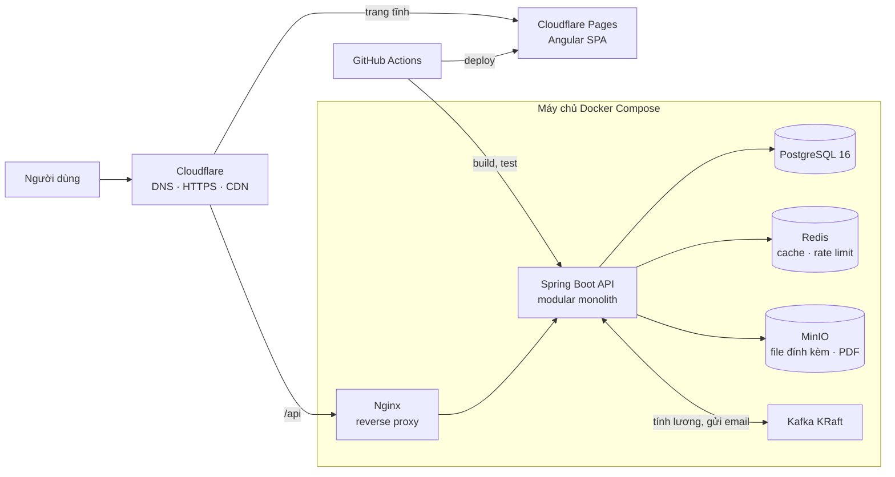
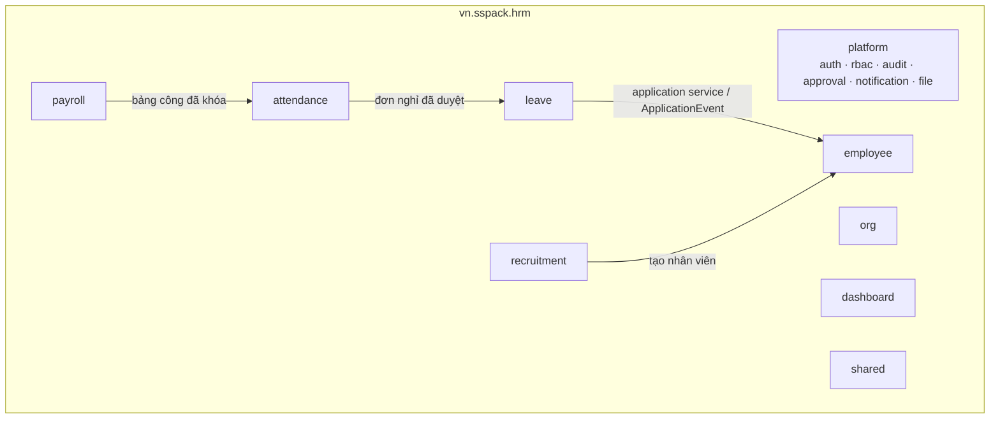

# SS Pack HRM

[](https://github.com/duchuy1412/sspack-hrm/actions/workflows/ci.yml)

Hệ thống quản lý nhân sự (HRM) web cho **SS Pack**, doanh nghiệp bao bì (công ty hư cấu dùng cho bản demo). Hệ thống bao phủ trọn vòng đời nhân sự: tuyển dụng → tiếp nhận → hồ sơ → chấm công, nghỉ phép → tính lương → nghỉ việc.

Đây là sản phẩm demo cho CV: chạy được trọn luồng, có test và có tài liệu. Yêu cầu chi tiết nằm trong [`docs/SRS.md`](docs/SRS.md), lược đồ CSDL trong [`docs/schema.sql`](docs/schema.sql).

> **Trạng thái:** đã dựng khung dự án. Các phân hệ nghiệp vụ sẽ được làm lần lượt theo mã user story trong SRS (PLT → ORG → EMP → LEV → ATT → PAY → REC → DSH).

## Công nghệ

| Phần | Công nghệ |
| --- | --- |
| Backend | Java 21, Spring Boot 3.5, Spring Data JPA, Spring Security, Flyway, springdoc-openapi, MapStruct |
| Frontend | Angular 21 (standalone, signals), Transloco (vi/en), Vitest |
| Dữ liệu và hạ tầng | PostgreSQL 16, Kafka (KRaft), Redis, MinIO, Mailpit, Docker Compose |
| Kiểm thử | JUnit 5, Testcontainers (PostgreSQL thật), ArchUnit, Vitest |
| CI | GitHub Actions |

## Kiến trúc

### Triển khai



### Backend: modular monolith

Mỗi phân hệ là một package dưới `vn.sspack.hrm`, chia bốn tầng `api` → `application` → `domain` ← `infrastructure`.



Quy tắc ranh giới (được kiểm tra tự động bằng ArchUnit trong `ModuleBoundaryTest`):

- Một module **không** gọi `domain` (entity) hay `infrastructure` (repository) của module khác.
- Module giao tiếp qua service công khai (`api`/`application`) hoặc sự kiện: Spring `ApplicationEvent` trong tiến trình, Kafka cho việc nặng như tính lương hay gửi email.
- `shared` không chứa nghiệp vụ và không phụ thuộc module nghiệp vụ.

## Cấu trúc thư mục

```
.
├── backend/            Spring Boot (Maven Wrapper)
│   └── src/main/resources/db/migration/   Flyway: V1__init.sql = docs/schema.sql
├── frontend/           Angular: layout/shell, features/<phân hệ> (lazy-load), styles/tokens.css
├── infra/              docker-compose.yml, .env.example
├── docs/               SRS.md, schema.sql
└── .github/workflows/  ci.yml
```

## Chạy local

### Yêu cầu

- JDK 21, Node.js 22 (≥ 22.12), Docker Desktop (đang chạy)
- Maven không cần cài riêng: dùng `./mvnw` (Windows: `.\mvnw.cmd`)

### 1. Hạ tầng

```bash
cp infra/.env.example infra/.env      # sửa cổng/mật khẩu nếu cần
docker compose -f infra/docker-compose.yml up -d
```

`infra/.env` được dùng chung bởi Docker Compose và backend. Ví dụ, nếu máy đã có PostgreSQL ở cổng 5432, đặt `DB_PORT=5433` là cả container lẫn backend cùng dùng cổng mới.

### 2. Backend

```bash
cd backend
./mvnw spring-boot:run -Dspring-boot.run.profiles=dev
```

Flyway tự tạo schema `hrm` và chạy migration khi khởi động. Profile `dev` mở thêm cổng debug **5005**: trong IntelliJ, tạo cấu hình *Remote JVM Debug* trỏ tới `localhost:5005`, hoặc chạy trực tiếp class `HrmApplication` bằng nút Debug.

Backend cần biến `JWT_SECRET` (tối thiểu 32 byte) để ký access token; `infra/.env.example` có sẵn giá trị cho local. Môi trường thật phải sinh khóa riêng: `openssl rand -base64 48`.

### Tài khoản demo (chỉ profile `dev`)

Profile `dev` nạp thêm tài khoản dùng thử (`db/dev/R__demo_users.sql`), mật khẩu chung **`Demo@2026`**. Các profile khác không có tài khoản này.

| Vai trò | Email |
| --- | --- |
| Quản trị hệ thống | `admin@sspack.vn` |
| Nhân sự | `thuha.le@sspack.vn` |
| Quản lý trực tiếp | `minhanh.tran@sspack.vn` |
| Nhân viên | `vanduc.pham@sspack.vn` |

Đăng nhập (PLT-01): access token JWT 15 phút trả trong body và chỉ giữ trong bộ nhớ trình duyệt; refresh token 7 ngày nằm trong cookie `HttpOnly; SameSite=Strict`, xoay vòng mỗi lần làm mới. Sai mật khẩu 5 lần liên tiếp thì tài khoản bị khóa 15 phút.

Phân quyền (PLT-03): Admin vào **Quản trị → Vai trò** để tạo vai trò, chọn quyền theo chức năng (`module:action`) và phạm vi dữ liệu; tab **Gán vai trò** gán vai trò cho tài khoản. Quyền được kiểm tra ở API (`@PreAuthorize` và chặn theo URL) lẫn giao diện (ẩn menu, chặn route, ẩn nút). Quyền nằm trong access token nên thay đổi có hiệu lực với người đang đăng nhập ở lần làm mới token kế tiếp, **tối đa 15 phút**; khi đó giao diện tự nạp lại quyền. Vai trò hệ thống không xóa được, không đổi phạm vi dữ liệu; vai trò Admin luôn giữ `role:manage`; Admin không tự gỡ quyền quản lý tài khoản của mình.

### 3. Frontend

```bash
cd frontend
npm ci
npm start
```

`npm start` proxy mọi request `/api` sang `http://localhost:8080` (xem `proxy.conf.json`).

### Địa chỉ

| Dịch vụ | Địa chỉ |
| --- | --- |
| Giao diện web | http://localhost:4200 |
| API backend | http://localhost:8080/api/v1 |
| Swagger UI | http://localhost:8080/swagger-ui.html |
| Health check | http://localhost:8080/actuator/health |
| PostgreSQL | `localhost:5432` (thông tin trong `infra/.env`) |
| Kafka | `localhost:9092` |
| Redis | `localhost:6379` |
| MinIO console | http://localhost:9001 |
| Mailpit | http://localhost:8025 |
| Debug backend | `localhost:5005` |

## Kiểm thử

```bash
# Backend: unit test + test tích hợp Testcontainers (cần Docker đang chạy)
cd backend && ./mvnw verify

# Frontend
cd frontend && npm test -- --watch=false && npm run build
```

CI chạy cả hai trên mỗi pull request.

## Quy ước

Quy ước code, phân quyền, định dạng dữ liệu và cách làm việc theo nhánh/commit nằm trong [`CLAUDE.md`](CLAUDE.md). Toàn bộ dữ liệu mẫu là hư cấu.
